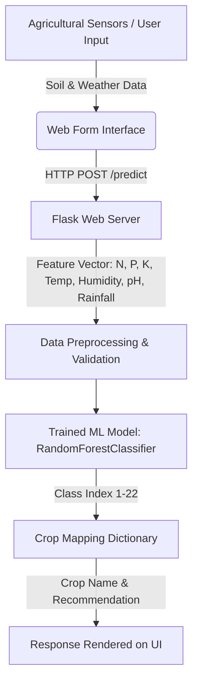

# 🌱 Precision Crop Classification & Recommendation System

[](https://www.python.org/)
[](https://flask.palletsprojects.com/)
[](https://scikit-learn.org/)
[](https://getbootstrap.com/)
[](LICENSE)

An intelligent, data-driven agricultural decision-support system that leverages machine learning to recommend the optimal crop for cultivation based on soil nutrient levels and environmental/meteorological parameters.

---

## 📌 Table of Contents

- [Overview](#-overview)
- [Key Features](#-key-features)
- [System Architecture](#-system-architecture)
- [Dataset & Feature Specification](#-dataset--feature-specification)
- [Machine Learning Pipeline](#-machine-learning-pipeline)
  - [Model Benchmarks & Comparison](#model-benchmarks--comparison)
  - [Selected Model](#selected-model)
- [Supported Crops](#-supported-crops)
- [Tech Stack](#-tech-stack)
- [Project Directory Structure](#-project-directory-structure)
- [Getting Started](#-getting-started)
  - [Prerequisites](#prerequisites)
  - [Installation & Setup](#installation--setup)
  - [Running the Application](#running-the-application)
- [API & Usage](#-api--usage)
  - [Web Interface](#web-interface)
  - [API Endpoint](#api-endpoint)
  - [Sample Test Cases](#sample-test-cases)
- [Future Roadmap](#-future-roadmap)
- [Contributing & License](#-contributing--license)

---

## 🌾 Overview

In modern agriculture, crop selection is often influenced by traditional practices without considering localized soil health and shifting climate conditions. Planting inappropriate crops leads to reduced yields, nutrient depletion, and financial losses for farmers.

The **Crop Classification & Recommendation System** solves this by analyzing 7 essential soil and environmental parameters (Nitrogen, Phosphorus, Potassium, Temperature, Humidity, pH, and Rainfall) to deliver precise, high-accuracy crop recommendations across 22 major agricultural crops.

---

## 🚀 Key Features

- **High-Accuracy Predictive Engine**: Powered by an ensemble `RandomForestClassifier` trained on verified agro-climatic data, achieving **>99% accuracy**.
- **Comprehensive Environmental Analysis**: Factors in both macro-nutrients ($N, P, K$) and atmospheric/soil conditions (temperature, humidity, soil pH, and precipitation).
- **Interactive Web Dashboard**: Clean, responsive UI built with Flask and Bootstrap 4 for seamless input submission and instant recommendations.
- **22 Supported Crop Profiles**: Covers cereals, pulses, fruits, and commercial cash crops.
- **Lightweight & Modular**: Easy to deploy locally, containerize with Docker, or host on cloud platforms (AWS, GCP, Render, Railway).

---

## 🏗️ System Architecture



---

## 📊 Dataset & Feature Specification

The model is trained on the verified agricultural dataset (`Crop_recommendation.csv`) containing 2,200 labeled observations across 22 distinct crop classes (100 samples per crop).

| Feature | Description | Measurement Unit | Range |
| :--- | :--- | :--- | :--- |
| **`Nitrogen (N)`** | Ratio of Nitrogen content in soil | $\text{kg/ha}$ | 0 – 140 |
| **`Phosphorus (P)`** | Ratio of Phosphorus content in soil | $\text{kg/ha}$ | 5 – 145 |
| **`Potassium (K)`** | Ratio of Potassium content in soil | $\text{kg/ha}$ | 5 – 205 |
| **`Temperature`** | Ambient environmental temperature | $\text{°C}$ | 8.8 – 43.7 |
| **`Humidity`** | Relative atmospheric humidity | $\%$ | 14.2 – 99.9 |
| **`pH`** | Soil acidity / alkalinity level | $\text{pH scale}$ | 3.5 – 9.9 |
| **`Rainfall`** | Seasonal precipitation volume | $\text{mm}$ | 20.2 – 298.6 |

---

## 🤖 Machine Learning Pipeline

### Model Benchmarks & Comparison

During model development, 11 different supervised learning algorithms were evaluated on a 70/30 stratified train-test split:

| Algorithm | Test Accuracy | Status |
| :--- | :---: | :---: |
| **Gaussian Naive Bayes** | **99.39%** | Evaluated |
| **Random Forest Classifier** | **99.24%** | 🏆 **Selected** |
| **Bagging Classifier** | **99.24%** | Evaluated |
| **Decision Tree Classifier** | **98.33%** | Evaluated |
| **Gradient Boosting Classifier** | **98.33%** | Evaluated |
| **K-Nearest Neighbors (KNN)** | **97.73%** | Evaluated |
| **Support Vector Machine (SVM)** | **96.36%** | Evaluated |
| **Linear Discriminant Analysis (LDA)** | **95.15%** | Evaluated |
| **Logistic Regression** | **94.70%** | Evaluated |
| **Extra Trees Classifier** | **91.82%** | Evaluated |
| **AdaBoost Classifier** | **21.06%** | Evaluated |

### Selected Model

The **Random Forest Classifier** was selected for production deployment due to:
1. **Exceptional Generalization**: Ensemble bagging of decision trees mitigates overfitting.
2. **Robust Multi-Class Separation**: Handles non-linear feature interactions between nutrient thresholds and climatic requirements.
3. **Low Latency Inference**: Near-instantaneous response times suitable for real-time web deployment.

---

## 🌿 Supported Crops

The system accurately classifies and recommends 22 major crop types:

| Category | Crops |
| :--- | :--- |
| **Cereals & Grains** | Rice, Maize |
| **Pulses & Legumes** | Chickpea, Kidneybeans, Pigeonpeas, Mothbeans, Mungbean, Blackgram, Lentil |
| **Fruits** | Pomegranate, Banana, Mango, Grapes, Watermelon, Muskmelon, Apple, Orange, Papaya, Coconut |
| **Cash Crops & Fibers**| Cotton, Jute, Coffee |

---

## 🛠️ Tech Stack

- **Backend**: Python 3.8+, Flask, Werkzeug
- **Machine Learning & Data Science**: Scikit-Learn, NumPy, Pandas, Matplotlib, Seaborn
- **Frontend**: HTML5, CSS3, Bootstrap 4, Jinja2 Templates
- **Model Serialization**: Pickle

---

## 📁 Project Directory Structure

```text
Crops-Classification-With-Recommendation-System/
├── Crop Classification With Recommendation System.ipynb   # Exploratory Data Analysis & Model Training
├── Crop Recommendation System Project Report.docx         # Comprehensive Project Documentation
├── Crop_recommendation.csv                                # Agricultural dataset (2,200 rows)
├── app.py                                                 # Flask application & routing
├── model.pkl                                              # Serialized production Random Forest model
├── requirements.txt                                       # Python dependencies
├── templates/
│   └── home.html                                          # Interactive UI template
└── README.md                                              # Project documentation
```

---

## ⚡ Getting Started

### Prerequisites

- Python `3.8` or higher
- `pip` package manager

### Installation & Setup

1. **Clone the repository:**
   ```bash
   git clone https://github.com/<your-username>/Crops-Classification-With-Recommendation-System.git
   cd Crops-Classification-With-Recommendation-System
   ```

2. **Create and activate a virtual environment:**
   - **Windows:**
     ```powershell
     python -m venv venv
     .\venv\Scripts\activate
     ```
   - **macOS / Linux:**
     ```bash
     python3 -m venv venv
     source venv/bin/activate
     ```

3. **Install dependencies:**
   ```bash
   pip install -r requirements.txt
   ```

### Running the Application

Launch the Flask development server:
```bash
python app.py
```

The server will start on:
- Local URL: **`http://127.0.0.1:5000`**
- Network URL: **`http://<your-ip>:5000`**

Open [http://127.0.0.1:5000](http://127.0.0.1:5000) in your web browser to access the dashboard.

---

## 💻 API & Usage

### Web Interface

1. Navigate to the homepage at `http://127.0.0.1:5000`.
2. Enter the field values for:
   - Soil macro-nutrients: **Nitrogen (N)**, **Phosphorus (P)**, and **Potassium (K)**.
   - Climate parameters: **Temperature (°C)**, **Humidity (%)**, **Soil pH**, and **Rainfall (mm)**.
3. Click **"Get Recommendation"**.
4. The predicted optimal crop will be displayed instantly on the card.

### API Endpoint

The application provides a POST endpoint for integration with mobile apps, IoT field sensors, or third-party platforms:

- **Endpoint**: `/predict`
- **Method**: `POST`
- **Content-Type**: `application/x-www-form-urlencoded`
- **Parameters**:
  - `Nitrogen` (integer)
  - `Phosporus` (integer)
  - `Potassium` (integer)
  - `Temperature` (float)
  - `Humidity` (float)
  - `pH` (float)
  - `Rainfall` (float)

### Sample Test Cases

| Scenario | N | P | K | Temp (°C) | Humidity (%) | pH | Rainfall (mm) | Expected Recommended Crop |
| :--- | :---: | :---: | :---: | :---: | :---: | :---: | :---: | :--- |
| **Tropical Orchard** | 21 | 26 | 27 | 27.0 | 47.7 | 5.7 | 95.8 | **Mango** |
| **High Rainfall Paddy** | 90 | 42 | 43 | 20.8 | 82.0 | 6.5 | 202.9 | **Rice** |
| **Temperate Orchard** | 24 | 128 | 196 | 22.6 | 92.3 | 5.9 | 112.7 | **Apple** |
| **High Potassium Field** | 23 | 134 | 204 | 33.8 | 81.7 | 6.2 | 70.3 | **Grapes** |

---

## 🔮 Future Roadmap

- [ ] **JSON REST API / FastAPI Transition**: Expose dedicated JSON endpoints with OpenAPI/Swagger docs for IoT integration.
- [ ] **Weather API Integration**: Auto-populate temperature, humidity, and forecast rainfall using OpenWeatherMap or Tomorrow.io APIs based on GPS location.
- [ ] **Fertilizer Recommendation Engine**: Suggest specific fertilizer doses based on nutrient deficits for the chosen crop.
- [ ] **Multi-Language Support**: Localize UI into regional languages (e.g., Bengali, Hindi, Spanish) for broader farmer accessibility.
- [ ] **Docker Containerization**: Include a `Dockerfile` and `docker-compose.yml` for single-command production deployment.

---

## 📄 Contributing & License

Contributions, bug reports, and feature requests are welcome! Feel free to open an issue or submit a Pull Request.

This project is licensed under the **MIT License** — feel free to use and adapt it for academic and commercial purposes.
